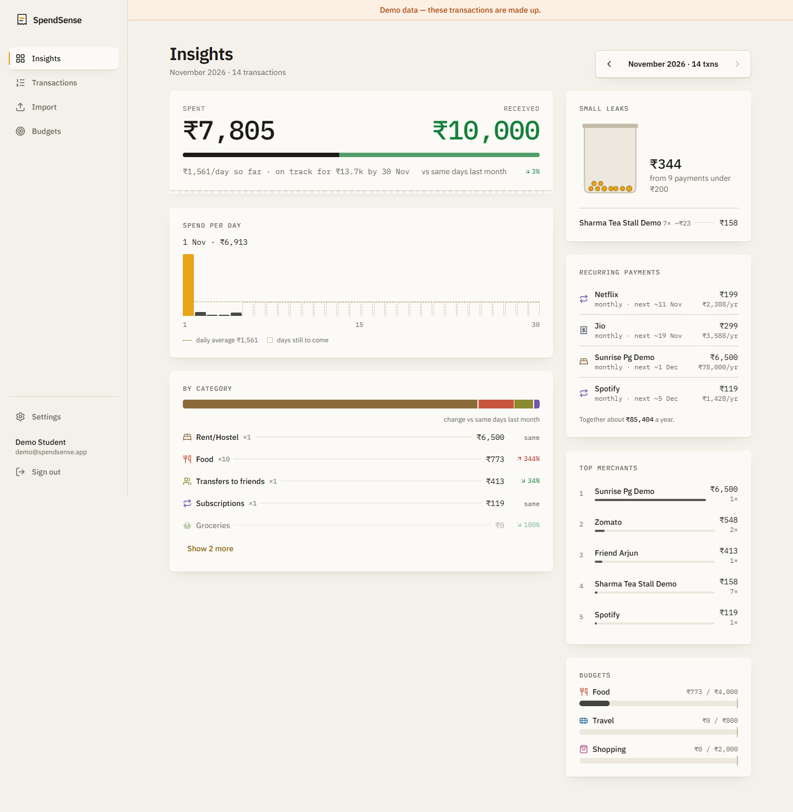
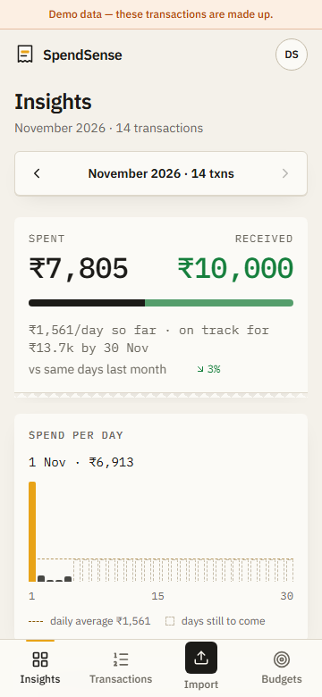
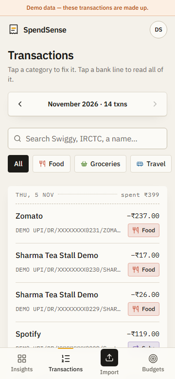
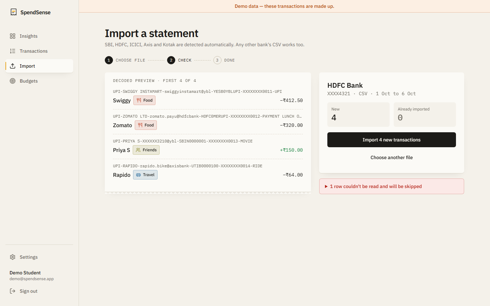
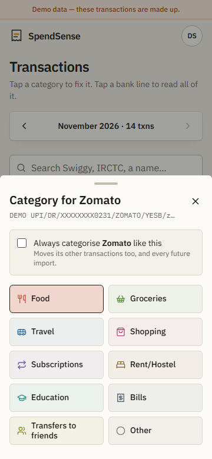
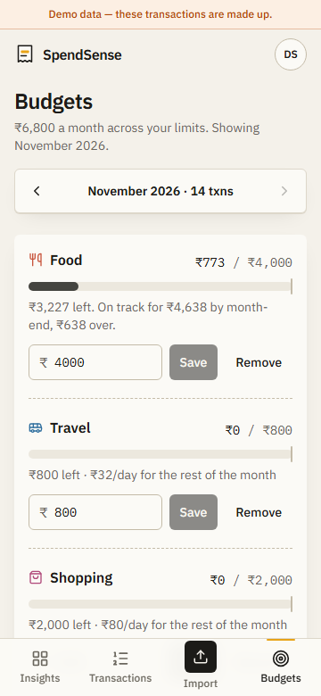
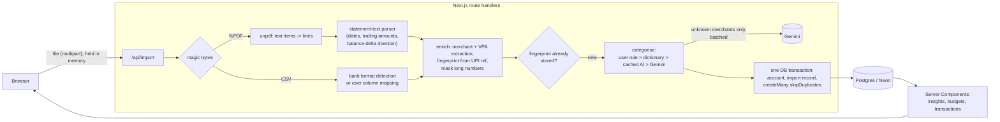

# SpendSense

Upload your bank statement and see where your UPI money actually went: by category, by merchant, and the small payments that quietly add up.

**Live demo:** TODO: add the Vercel link after deploying.

## Who is this for and what problem does it solve?

College students in India pay for almost everything through UPI: chai, canteen lunches, Rapido rides, Swiggy, hostel rent and splits with friends. At the end of the month the bank statement is a long list of lines like

```
TO TRANSFER-UPI/DR/412345678901/SWIGGY/YESB/swiggy@ybl/Payment--
```

so nobody can say how much went to food versus travel, which subscriptions are still charging, or that ₹20 chai payments are costing ₹1,800 a month.

SpendSense reads the statement you already have (CSV or PDF from SBI, HDFC, ICICI, Axis, Kotak, or any bank via column mapping). It turns each line into a merchant and a category and shows a plain monthly picture. The uploaded file is never stored.

## Screenshots

All screenshots use the seeded DEMO account (made-up transactions).

| Insights (desktop) | Insights (phone) | Transactions (phone) |
|---|---|---|
|  |  |  |

| Import preview | Re-categorise sheet | Budgets |
|---|---|---|
|  |  |  |

More in [`docs/`](docs/): landing page (light and dark), dark-mode dashboard, settings.

## Features

- **Import statements:** CSV and PDF, with the bank detected automatically (SBI, HDFC, ICICI, Axis, Kotak).
  - Password-protected PDFs are supported. The password is used once in memory.
  - Any other bank's CSV goes through a column-mapping screen.
  - You see a preview ("142 new, 38 already imported") before anything is saved.
- **Dedup across uploads:** overlapping statements, or the PDF and CSV of the same month, never create duplicate rows.
- **Merchant decoding:**
  - The VPA and payee name are pulled out of UPI narrations for each bank's layout.
  - Names are normalised, so `SWIGGY`, `swiggy-instamart` and `Swiggy Ltd` all become **Swiggy**.
  - Payments to friends are recognised from personal UPI handles.
- **Categorisation, rules first:**
  - A built-in dictionary covers about 55 common merchants and patterns, and handles most rows.
  - Gemini is asked only about merchants nobody has seen before, in batches. Its answers are validated with zod and cached, so the same merchant is never sent twice.
- **Learns from corrections:** tap a category to fix it. Choosing "Always categorise Swiggy as Groceries" turns it into a rule that re-labels past rows and applies to every future import.
- **Insights for any month:**
  - Spent vs received, with month-over-month change per category.
  - Daily average and projected month-end spend. Rent, bills and subscriptions are counted once, not extrapolated. Mid-month comparisons use the same days of last month.
  - Top merchants.
  - Auto-detected recurring payments and subscriptions, with the next expected date and yearly cost.
  - "Small leaks": many payments under ₹200 that add up.
- **Budgets per category:** progress bars, a warning at 80%, and an over-budget state. Shows what you can still spend per day, and whether your current pace will overshoot.
- **Privacy:**
  - The file is parsed in memory and dropped; only parsed transactions are stored.
  - Account numbers are reduced to their last 4 digits.
  - Long numbers in narrations (account numbers, phone-number VPAs) are masked.
  - Gemini only sees the payee name and a masked narration, never amounts or dates.
  - "Delete all my data" and "Delete my account" are in Settings.
- **Export:** CSV export of all transactions, safe against spreadsheet formula injection.
- **Usage tracking:** a small `UsageEvent` table (signup, login, import, re-categorise, budget, export, delete) with no content or PII. `npm run stats` prints honest numbers.

## Tech stack

- Next.js 16 (App Router), React 19, TypeScript (strict, `noUncheckedIndexedAccess`)
- Tailwind CSS v4 with custom design tokens; IBM Plex Sans and Mono
- PostgreSQL on Neon, through Prisma 7 with the `pg` driver adapter
- Auth.js (next-auth v5) credentials login with bcrypt-hashed passwords and JWT sessions
- zod for all input validation (API bodies, AI responses, column mappings)
- Google Gemini (`@google/genai`) for unknown merchants only
- `unpdf` (pdf.js) for PDF text extraction and Papa Parse for CSV
- Vitest for tests

## Architecture



Folder layout:

- `src/lib/` holds pure, tested logic (parsers, UPI extraction, dedup, categorisation, insights, budget maths).
- `src/server/` holds DB access, auth, Gemini and the import pipeline.
- `src/app/` holds pages and API routes.
- `src/components/` holds the UI.

## Design decisions

1. **Integer paise, never floats.**
   - Every amount is parsed straight from the bank's string into an `Int` of paise, and rupees appear only when formatting.
   - Alternatives: `Decimal` columns, or JS numbers in rupees. JS floats drift (`0.1 + 0.2`), and `Decimal` needs a library on both sides.
   - Trade-off: the limit is about ₹2.1 crore per row (Postgres `int4`), which is fine for a student's statement.
2. **Dedup by fingerprint, with the UPI reference preferred.**
   - Each row's identity is `date | direction | amount | UPI ref (or normalised narration) | same-day occurrence`, hashed and stored with a unique `(userId, fingerprint)` index.
   - The UPI reference survives the different narration formatting in a bank's PDF and CSV exports.
   - The occurrence counter keeps two genuine ₹20 chai payments on the same day as two rows.
   - Alternative: matching on date + amount + balance. That fails for generic CSVs without a balance, and for PDF vs CSV whitespace.
   - Trade-off: if an upload covers only half of a day that later appears in full, a same-day identical payment without a reference could be counted once too few.
3. **Rules before AI, with AI answers cached as rules.**
   - Order: the user's corrections, then a hand-written dictionary, then earlier Gemini answers, and only then a batched Gemini call for merchants nobody has seen.
   - Most rows never touch the AI, imports stay fast, the free tier lasts, and results are explainable ("why is this Food?").
   - Alternative: send every row to an LLM. That is slower, costs more, behaves differently from run to run, and sends more data out.
   - Trade-off: the dictionary needs maintenance, and its patterns are India-specific.
4. **Preview, then commit, without storing the file.**
   - The browser keeps the `File` object and sends it twice: once for a preview, then again to import.
   - The server never writes it to disk or blob storage.
   - Alternative: upload once and keep the file in temporary storage. That means a stored copy of a bank statement, which the privacy promise rules out.
   - Trade-off: large PDFs are parsed twice.
5. **PDFs are parsed as positioned text, and direction comes from balance movement.**
   - In extracted PDF text the empty debit or credit column disappears, so a row looks like `amount balance`.
   - The parser checks whether `previous balance − amount = balance` to decide debit vs credit. It falls back to Dr/Cr markers, then to keywords.
   - Alternative: per-bank table extraction by x-coordinates. That is more precise, but breaks every time a bank tweaks its layout.

## How to run locally

Requirements: Node 20+ and a Postgres database (a free Neon project works).

```bash
cp .env.example .env      # fill in DATABASE_URL and AUTH_SECRET (GEMINI_API_KEY optional)
npm install               # also generates the Prisma client
npm run db:migrate        # creates the tables
npm run dev               # http://localhost:3000
```

Optional demo data: set `SEED_DEMO_EMAIL` and `SEED_DEMO_PASSWORD` in `.env`, run `npm run db:seed`, then sign in with those details. Every demo transaction is labelled `DEMO`, and the app shows a demo banner for that account.

Checks:

```bash
npm test          # parsers (fixtures for every bank), UPI extraction, dedup, categorisation, recurring, leaks, budgets
npm run lint
npm run build
npm run stats     # usage numbers, excluding the demo account
```

Test fixtures in `src/lib/fixtures/` are fake statements made for this project. They contain no real people or accounts.

## Deploy

Free tiers: Vercel (app) + Neon (Postgres).

1. **Neon:** create a project and copy the **pooled** connection string. Change `sslmode=require` to `sslmode=verify-full`.
2. **Vercel:** import the GitHub repo. The framework is detected as Next.js. `vercel.json` sets the build command to `npm run vercel-build`, which runs `prisma migrate deploy && next build`.
3. **Environment variables (Vercel → Settings → Environment Variables):**

   | Variable | Required | What it is |
   |---|---|---|
   | `DATABASE_URL` | yes | Neon pooled connection string |
   | `AUTH_SECRET` | yes | random 32+ byte secret (`npx auth secret`) |
   | `GEMINI_API_KEY` | no | from Google AI Studio; without it, unknown merchants stay "Other" |
   | `GEMINI_MODEL` | no | defaults to `gemini-flash-lite-latest` |

4. Deploy, open the URL, sign up, and import a statement.
5. TODO: paste the live link at the top of this README.

## Limitations and what breaks at scale

- **Scanned PDFs (photos of paper) aren't supported.** There is no OCR. Downloaded e-statements work.
- **Excel exports (.xls/.xlsx) aren't read directly.** The user has to save them as CSV first.
- **Bank layouts change.** Each bank's format is a set of header names and regexes. A layout change can break one bank until the parser is updated. Fixtures make the breakage visible, but real statements vary more than fixtures.
- **Person-vs-shop detection is a heuristic.** Small shops on personal Google Pay handles (`@okaxis`, …) are shown as "Transfers to friends" until corrected.
- **Insights are computed per request in Node.** That is fine for a few thousand rows per user. For years of data or many users it should move to SQL aggregates or a materialised monthly summary table.
- **The import pipeline runs inside one request.** A large PDF plus a slow Gemini call can take 20+ seconds on serverless. At scale this becomes a background job with a status poll.
- **Rate limiting is per user, through the DB** (20 imports an hour). Sign-up and login have no IP-based throttling. A public launch needs an edge rate limiter (e.g. Upstash).
- **The Gemini free tier is often overloaded (503s or slow responses).** Imports still succeed, with those merchants left as "Other", but categorisation quality then depends on the user tapping to fix them.
- **No household or multi-currency support.** It assumes one person's INR accounts.

## What I learned

- Bank statements are far messier than the column headers suggest: wrapped narrations, summary blocks under the table, `0.00` placeholders, `Dr`/`Cr` suffixes on balances, and two-digit years. Fixture-driven tests were the only way to stay sane.
- In PDFs the empty debit or credit column simply vanishes. Using the running balance to infer direction turned out more reliable than trying to rebuild columns.
- A clear identity for each row (the fingerprint) makes "import the same thing twice" a non-event. It also makes concurrent uploads safe for free, through a unique index and `skipDuplicates`.
- Putting the LLM last, behind deterministic rules and a cache, made the feature faster, cheaper and easier to explain than "AI categorises everything".

## What I'd improve next

- Background imports with progress, plus OCR for scanned statements.
- Show the parsed rows the parser rejected inline, with a one-tap fix, instead of only listing them in the preview.
- An SMS/email alert parser, so spending shows up daily instead of only when a statement is uploaded.

## GitHub

**About:** Upload an Indian bank statement (CSV/PDF) and see where your UPI money went: categories, merchants, subscriptions, small leaks and budgets. Built for students.

**Topics:** `nextjs` `upi` `personal-finance` `bank-statement-parser` `prisma`
